# Hi there, I'm Prashant 👋

A B.Tech AI student at IIT Gandhinagar, passionate about AI, programming, and learning new things.

  

## 🚀 About Me

- 🎓 Currently pursuing B.Tech in Artificial Intelligence at IIT Gandhinagar.
- ⭐ Secretary, IITGN Quizzing Society
- 🤖 Exploring AI and Machine Learning

## 📫 Connect With Me

  
  
  

## 🛠 Languages & Tools

  

## 📊 GitHub Stats:

